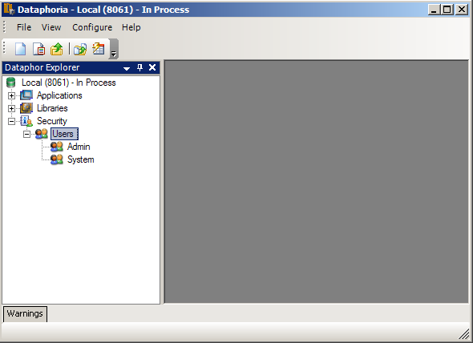
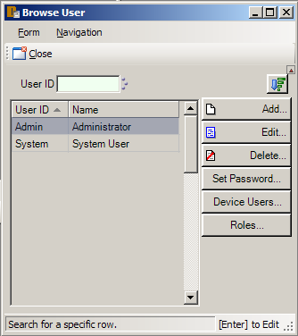
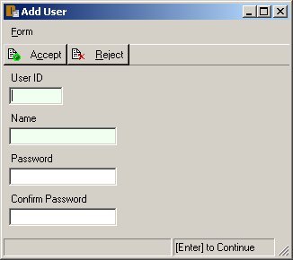

# Security

## Summary

Dataphoria provides various user interfaces for managing the security model of the Dataphor Server. The Security node displays the Users as child nodes:

Right-clicking on the Security node and selecting the Manage Users command displays the following user interface:

This user interface allows for the administration of all users. Note that the capabilities available from this form still require an appropriate authorization check. If a user with access to this form does not have the rights to perform a particular operation, an error message will be displayed.

## Users

The Manage Users form provides for the management of all users in the system. The following screen capture displays the User Edit form:

The User ID is the case-insensitive identifier for the user within the Dataphor Server. This is the User ID used when logging in to the server from the Dataphor Server Login form, or when using a configured alias.

The Name is the display name for the user, and is not used by the Dataphor Server.

Password is case-sensitive and the entry is masked. The Confirm Password entry is used to guarantee correctness of the password. The Password and Confirm Password must match before the form can be accepted.

### Device Users

The Device Users… button displays the list of device user mappings for the currently selected user. These mappings provide deivce-specific authentication information for the user. The settings provided for a user override the authentication settings for the device. For more information on device users, refer to the Dataphor Developer’s Guide.

### User Roles

The Roles… button displays the list of roles to which the the currently selected user belongs. For more information on roles and other security primitives, refer to the Security chapter later in this guide.
